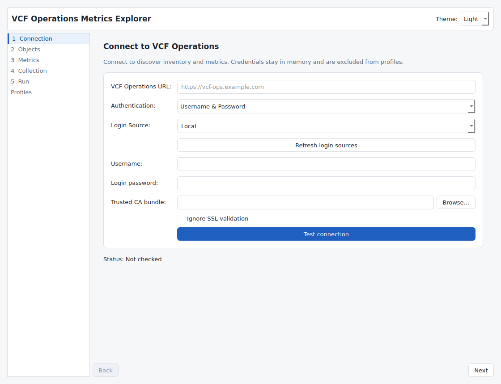
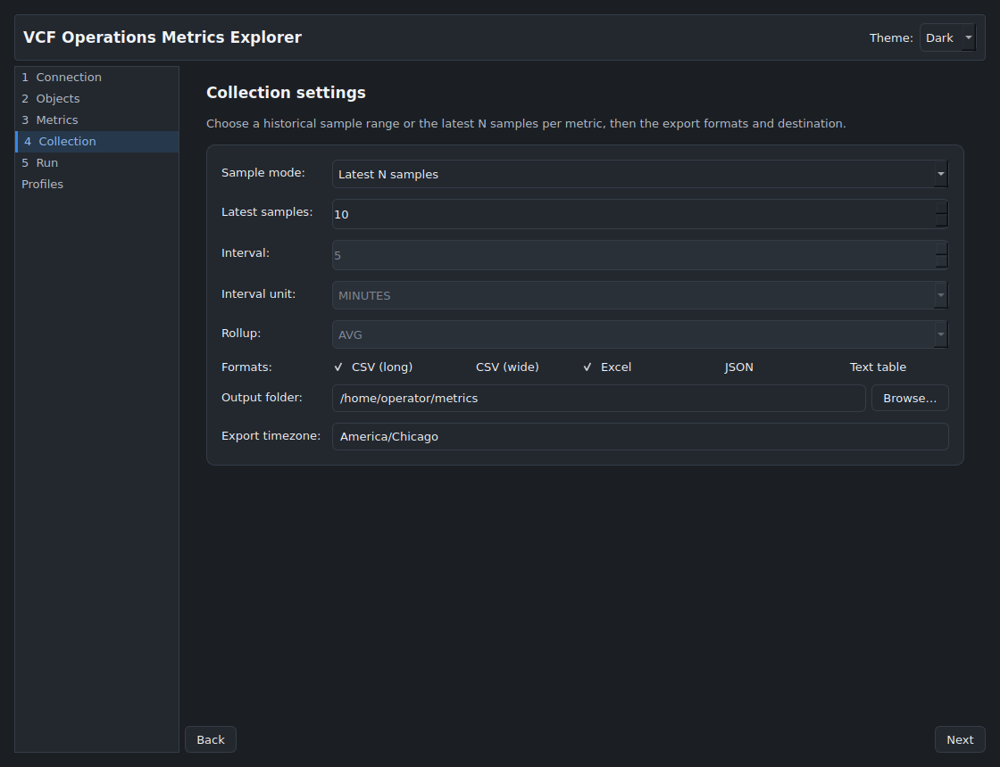

# VCF Operations Metrics Explorer

VCF Operations Metrics Explorer is a lightweight, cross-platform utility that connects to VMware Cloud Foundation Operations (formerly Aria Operations / vRealize Operations) to discover inventory objects, select metrics and current properties, execute multi-group historical collection jobs, and export aligned results to CSV, Excel (.xlsx), and JSON.

The application includes a native PySide6 Qt Widgets desktop app styled with Lattice and a fully scriptable CLI backed by the same collection engine. It packages into a single standalone executable on Windows, macOS, and Linux without requiring users to install Python or other runtimes.

---

## Quick Start

### Standalone Executable

Download the precompiled release binary for your platform from GitHub Releases, or build locally:

```bash
# Launch the native desktop application
./ops-metric-harvest gui

# Or run headless collection directly from the CLI
./ops-metric-harvest collect --server vcf-ops.example.com --user admin --kind HostSystem --sample-size 7d --format both
```

### From Python Source

Python 3.9 or newer is supported:

```bash
# Clone the repository
git clone https://github.com/sentania-labs/ops-metric-harvest.git
cd ops-metric-harvest

# Install the desktop application and development dependencies
python3 -m pip install -e ".[dev]"

# Launch the native app (default action when run without arguments)
python3 -m ops_metric_harvest.cli

# Run automated tests
QT_QPA_PLATFORM=offscreen python3 -m pytest -v
```

---

## Comparison: Reference Implementation Heritage

This project combines the strengths and resolves the defects identified during source review of two reference implementations:

| Feature / Area | Reference A (vropsMetrics, PowerShell) | Reference B (vcf_operations_metric_picker, Python) | VCF Operations Metrics Explorer (This Project) |
|---|---|---|---|
| **Language & Runtime** | PowerShell script (Windows-centric) | Python standard library scripts | Pure Python core packaged as cross-platform native executables |
| **TLS Verification** | Broken: assignment bug `if ($ignoreSSL = $true)` unconditionally disabled TLS | Disabled by default | Enabled by default; explicit `--insecure` flag with clear warning |
| **CSV Object Import** | Broken: `-Header` parameter caused column titles to be parsed as inventory objects | Not supported | Flexible CSV parsing with automatic header detection and name resolution |
| **Inventory Pagination** | Single query with `pageSize=100000` (fails on large estates) | Iterative page loop (`pageSize=1000`) | Robust iterative pagination with client-side name/query filtering |
| **Collection Semantics** | Batched `/resources/stats` historical range queries | Per-resource `/resources/stats/latest` latest-N-samples queries | Both supported: historical range/rollup is canonical, with latest-N fallback |
| **Request Batching & Limits** | All IDs in a single GET query string (exceeds URL limits) | One HTTP request per object via thread pool | Bounded batching (up to 40 resources per query) with fallback to single queries |
| **Timestamp Alignment** | Assumed identical timestamps across all metrics (indexes corrupt on gaps) | Union of timestamps with `None` fill | Full timestamp union alignment across all metrics, objects, and groups |
| **Collection Groups** | Single resource kind per run | Single object type and single stat list | Multiple independent groups with deduplicated querying and clean attribution |
| **Export Formats** | CSV only (separated by kind) | Custom standard-library XLSX and JSON | Canonical long CSV, wide CSV, multi-sheet XLSX (with sheet splitting), JSON, and terminal table |
| **Formula Injection Protection** | None | None | Sanitizes values starting with `=`, `+`, `-`, `@`, `\t`, `\r` |
| **Profile Management** | None | Browser localStorage only | Versioned JSON profile schema (`schema_version: "2.0"; loads 1.0 profiles`), shared between GUI and CLI |

---

## CLI Reference

The CLI separates structured data on stdout from operational progress on stderr, making it safe for automation pipelines.

### Subcommands

```bash
# Test server connectivity and authentication
./ops-metric-harvest connect test --server vcf-ops.example.com --user admin

# Discover supported resource kinds
./ops-metric-harvest objects kinds --server vcf-ops.example.com --token "$VCFOPS_TOKEN"

# Search for specific inventory objects
./ops-metric-harvest objects search --server vcf-ops.example.com --token "$VCFOPS_TOKEN" --kind VirtualMachine --query "db"

# List metric catalogue definitions and units
./ops-metric-harvest metrics list --server vcf-ops.example.com --token "$VCFOPS_TOKEN" --kind HostSystem --filter "cpu"

# Validate a saved collection profile JSON file
./ops-metric-harvest profiles validate examples/profiles/scenario_a_all_hosts.json

# Execute an ad-hoc collection
./ops-metric-harvest collect \
  --server vcf-ops.example.com \
  --token "$VCFOPS_TOKEN" \
  --kind HostSystem \
  --objects all \
  --stat-keys "cpu|capacity_usagepct_average,mem|active_average" \
  --sample-size 7d \
  --format csv,xlsx \
  --output ./esx_metrics

# Execute a saved collection profile
./ops-metric-harvest profiles run examples/profiles/scenario_c_two_vm_groups.json \
  --token "$VCFOPS_TOKEN" \
  --output ./vm_groups_output
```

### Exit Codes

- `0`: Success (all requested objects and metrics collected).
- `1`: Fatal error (authentication rejected, network failure, or invalid profile).
- `2`: Partial success (warnings recorded or subset of metrics/objects returned null).

---

## Native desktop app

Run `ops-metric-harvest gui`, or double-click the standalone executable. The app uses Qt Widgets with the shared [Lattice](https://github.com/sentania-labs/lattice) QSS and palette, a light default, and a Light / Dark theme picker. Start in dark mode with `ops-metric-harvest gui --theme dark`.



1. **Connection**: Enter the VCF Operations URL, select username/password or OpsToken, and test the connection. Refresh the login source picker or enter a source manually. Browse for a trusted CA bundle, or explicitly ignore SSL validation with a visible warning.
2. **Objects**: Connect to discover live adapters and types. Search names within a type, browse server pages, and check individual objects for a fixed set of IDs, or choose all matching the type/filter for a dynamic selection. Counts come from the server; absent totals are shown as unknown. Review or clear the selection at any time. Parents and children open paged relationship views. Browse a related type to select it in its own group. Paste/import is a secondary path that resolves exact names or IDs and reports ambiguous and unresolved names.
3. **Fields**: One searchable, grouped catalogue with Metrics and Properties tabs shows keys, units and descriptions plus a selected basket. Each adapter/type has its own collection group and basket; changing a selected scope preserves it in a separate group. Properties come from the server catalogue. If discovery fails, the Properties tab is disabled with the API error. Starter metrics and raw keys remain fallbacks.
4. **Collection**: Choose a relative duration, absolute UTC range using calendar controls, or latest N samples. Select rollup settings, export timezone, long/wide CSV, Excel, JSON, or text table, and an output folder with a native picker.
5. **Run**: Review the group scope, start collection, monitor progress, and cancel between requests. Closing during a request waits for that operation to finish. The summary shows objects, samples, warnings, errors, output paths, and a preview of up to 200 samples. Each run writes into a new timestamped subfolder, avoiding overwriting earlier exports. Export failures leave the result preview available.
6. **Profiles**: Save the full job as schema 2.0 JSON, shared with the CLI: groups, selectors, metric/property keys, time and export settings. Version 1.0 profiles still load. Fixed selections reuse the saved resource IDs; dynamic selections re-evaluate the type/filter on every run and may include new objects. Missing IDs and ambiguous legacy names are reported. Profiles exclude passwords and tokens. Loading clears current credentials.



Properties are always the latest string values, independent of the historical metric range or latest-N setting. The API supplies no property source timestamp, so property rows record collection time with `FieldType=property` and `TimestampBasis=collection`. Missing values remain null and are reported in results. Long CSV/XLSX and JSON distinguish field type and timestamp basis; wide exports label property columns separately even when a metric has the same key.

CLI `profiles run` honors saved property selections, output folders and `csv_wide` exports as well as existing metric profiles.

The GUI has no web server or embedded browser. Network and engine operations run in a background Qt thread. The CLI commands and collection engine retain their existing behavior. Cancellation is cooperative; the current request and its configured retry budget may finish before the app stops.

For development, `make smoke-gui` launches under Xvfb, captures the connection screen, and exits. Set `GUI_SCREENSHOT` to choose the PNG path. CI also launches the packaged executable and retains its screenshots as artifacts.

---

## Collection Profile Format

Profiles use schema version 1.0. Profiles define job selectors and output settings, and never store passwords or authentication tokens.

Example profile:

```json
{
  "schema_version": "1.0",
  "name": "Scenario A: All Host Systems",
  "connection": {
    "server": "vcf-ops.example.com",
    "verify_ssl": true
  },
  "time_range": {
    "mode": "relative",
    "relative_preset": "7d",
    "interval_minutes": 5,
    "interval_type": "MINUTES",
    "rollup_type": "AVG"
  },
  "groups": [
    {
      "group_id": "all-hosts",
      "name": "All ESXi Hosts",
      "resource_kind": "HostSystem",
      "selector": {
        "resource_kind": "HostSystem",
        "selection_mode": "all",
        "adapter_kind": "VMWARE"
      },
      "metric_set": {
        "stat_keys": [
          "cpu|capacity_usagepct_average",
          "cpu|coreUtilization_average",
          "mem|active_average"
        ]
      }
    }
  ],
  "export_config": {
    "formats": ["csv", "xlsx", "json"],
    "timezone": "America/Chicago"
  }
}
```

Pre-built profiles covering the three primary operational scenarios are included in `examples/profiles/`:
- `scenario_a_all_hosts.json`
- `scenario_b_selected_vms.json`
- `scenario_c_two_vm_groups.json`

---

## Operational & Security Considerations

- **Blast Radius**: `ops-metric-harvest` is read-only against the VCF Operations Suite API. It creates no objects, alters no configurations, and issues only GET requests for inventory and metric data.
- **Native UI**: No listener or browser session is created. The desktop connects directly to the Operations API over HTTPS.
- **Secrets Handling**: Authentication credentials stay in process memory until cleared, replaced by a loaded profile, or the app closes. Profiles exclude passwords and tokens; task errors and progress redact supplied runtime credentials.
- **Formula Injection Defense**: All CSV and Excel string cells beginning with `=`, `+`, `-`, `@`, `\t`, or `\r` are prefixed with a single quote to prevent code execution when opened in spreadsheet software.
- **Resource Exhaustion Prevention**: Historical queries are automatically chunked into batches of up to 40 resources to avoid HTTP 414 URL length errors and proxy buffer limits.

---

## Acceptance Criteria Checklist

| Requirement | Description | Status | Evidence |
|---|---|---|---|
| **AC1** | All hosts: Historical query across all `HostSystem`s with CSV and XLSX export | PASS | `tests/test_scenarios.py::test_scenario_a_all_hosts` |
| **AC2** | Selected VMs: Explicit selection of three VMs | PASS | `tests/test_scenarios.py::test_scenario_b_selected_vms` |
| **AC3** | Distinct VM groups: Multi-group collection with shared overlap and clean attribution | PASS | `tests/test_scenarios.py::test_scenario_c_distinct_vm_groups_with_overlap` |
| **AC4** | Profile reproducibility: Create profile, save JSON, execute identically via CLI | PASS | `tests/test_scenarios.py::test_scenario_d_profile_reuse` |
| **AC5** | Discovery: Paginated inventory discovery, name search, metric catalogue lookup | PASS | `tests/test_client.py::test_client_pagination`, `test_engine.py` |
| **AC6** | Failure behavior: Throttling, bad auth, duplicate names, cancellation | PASS | `tests/test_client.py`, `test_engine.py`, `test_scenarios.py` |
| **AC7** | Data integrity: Misaligned timestamps, null alignment, value preservation | PASS | `tests/test_scenarios.py::test_scenario_e_error_resilience` |
| **AC8** | Distribution: Packaged executables with signing and notarization hooks | PASS | PyInstaller spec, `packaging/build.py`, CI & Release workflows |
| **AC9** | Automation: Non-interactive execution, secure credentials, exit codes | PASS | `tests/test_cli.py`, `test_scenarios.py` |

---

## License

This project is licensed under the MIT License. See [LICENSE](LICENSE) for details.
Attribution is preserved for reference works by Scott Robert Bowe (`vropsMetrics`) and Brock Peterson (`vcf_operations_metric_picker`).
